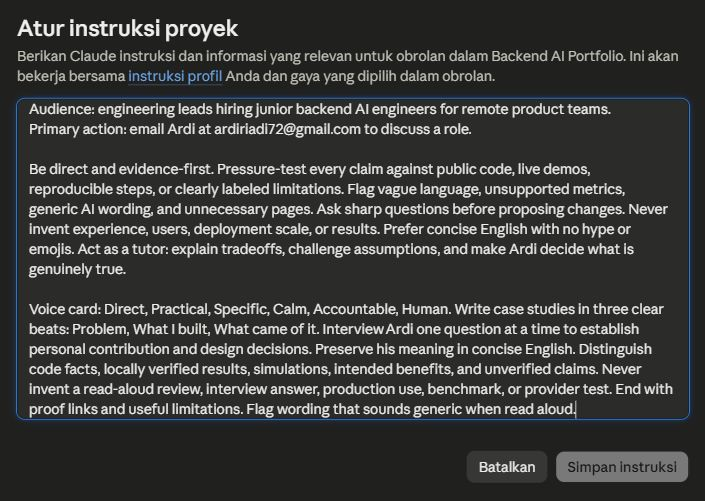

# Frame It as Cases

**Ardi Riyadi · AI Fluency portfolio · 08 October 2026**

**Voice card:** Direct · Practical · Specific · Calm · Accountable · Human

**Audience:** Engineering leads hiring junior backend AI engineers for remote product teams.

**One action:** Email [ardiriadi72@gmail.com](mailto:ardiriadi72@gmail.com) to discuss a role.

**Final author review:** Ardi confirmed the full case copy and voice card on 08 October 2026: “Sudah dibaca keras dan sesuai.” This document was prepared with AI assistance using project documents and inspectable code. The voice card and three-beat structure were saved to the Claude Project and verified.

## 1. Internship Progress Copilot API

### Problem

In my self-paced FlyRank internship, I found it difficult to choose the next task and manage its evidence. Repeatedly checking instructions, status, repositories, and supporting documents took time from the work itself. I chose this problem from my own internship experience and wanted one place for tasks, next-step recommendations, evidence, and progress reports.

### What I built

I kept the scope around tasks, next steps, and evidence so I could build one complete workflow. I chose SQLite to avoid adding a separate database service. The Express API stores tasks, assignment evidence, plans, jobs, and reports, with JWT authentication protecting private routes. The planning endpoint validates a goal, constraints, and assignment IDs and caches identical requests for ten minutes.

I put PDF creation in a background job that returns HTTP 202 and supports status polling and retries. I also kept a deterministic demo mode so the workflow can run without a paid API key, with optional OpenAI-compatible integration. The repository includes Swagger documentation, Docker configuration, and Prometheus request, latency, error, and runtime metrics.

### What came of it

The project provides an inspectable path from a saved task to a structured plan and a generated PDF report. On 08 October 2026, the existing local-demo test suite passed all six cases covering health, metrics, protected CRUD, authentication, caching, and PDF job completion. My intended benefit is faster prioritization and submission preparation, with evidence that is easier for a reviewer to follow. That benefit is a target; I have not measured a tenfold time saving or production adoption.

**Proof:** [Capstone explanation](https://github.com/ardiradi/flyrank-10x-solution/blob/main/docs/My%2010x%20Solution%20-%20Ardi%20Riyadi.md), [API routes](https://github.com/ardiradi/flyrank-10x-solution/blob/main/src/app.js), [planner](https://github.com/ardiradi/flyrank-10x-solution/blob/main/src/services/aiPlanner.js), [test cases](https://github.com/ardiradi/flyrank-10x-solution/blob/main/test/app.test.js).

## 2. PharmaCheck AI

### Problem

A pharmaceutical material label can carry a material name, batch number, and expiry date among many other fields. The project focuses on making those values easier for a person to find and inspect, rather than making a quality or medical decision.

### What I built

I worked on PharmaCheck myself. I built a Streamlit interface that accepts an image or PDF and sends its bytes to Azure AI Document Intelligence's `prebuilt-document` model. I mapped returned key-value pairs to three primary fields through explicit keyword groups and kept additional fields and raw OCR text available, so a reviewer can check the extracted values against the document.

### What came of it

The repository contains a document extraction prototype, a public sample label, and a linked demo. The result is an interface that brings three important fields into view while preserving the source text for review. It does not yet normalize dates, validate batch formats, or maintain a persistent audit trail. No extraction accuracy or time-saving result is claimed here.

**Demo availability note, updated 09 October 2026:** The hosted Space reported an error when checked on 08 and 09 October 2026.

**Proof:** [Scope and limitations](https://github.com/ardiradi/PharmaCheck-AI-Core/blob/main/README.md), [upload, keyword mapping, and review interface](https://github.com/ardiradi/PharmaCheck-AI-Core/blob/main/app.py), [PharmaCheck Space status](https://ard11-pharmacheck-ai.hf.space/).

## 3. EcoVision

### Problem

EcoVision explores an application flow in which two macroeconomic inputs produce a purchasing-power score and an Indonesian-language recommendation. The current project is an educational prototype: its input data and target are synthetic, so it cannot demonstrate how real Indonesian businesses or households behave.

### What I built

I worked on EcoVision myself. I kept two inputs to make the demo simple and the training, API, and dashboard flow easier to test and repeat. The training script generates 500 synthetic rows from interest rate, stock-market index, and a target formula with noise, then trains a RandomForestRegressor with a fixed seed and an 80/20 split. I exposed the same two inputs through FastAPI `/predict`, connected a static dashboard, and added a Dockerfile. Recommendation text follows visible score thresholds rather than an LLM.

### What came of it

I produced a complete input-to-response demo: dashboard, API, serialized model, and rule-based explanation. The training script calculates metrics on the synthetic test split. Because the input-to-score relationship comes from my constructed formula, the result reflects the simulation's assumptions; it does not validate society's purchasing power or benefits to businesses.

**Proof:** [Documented scope](https://github.com/ardiradi/AI-Impact-Datathon-2026/blob/main/README.md), [synthetic data and training](https://github.com/ardiradi/AI-Impact-Datathon-2026/blob/main/train.py), [API and recommendation rules](https://github.com/ardiradi/AI-Impact-Datathon-2026/blob/main/main.py), [dashboard link](https://prediksi-ai-ecovision-datathon.netlify.app/).

## 4. Heart Disease ML Pipeline

### Problem

A model-training result alone does not show how to serve predictions, retain experiment evidence, or inspect a running service. This Dicoding learning project extends the work across experimentation, training, CI, serving, and monitoring.

### What I built

I worked on this pipeline myself. I built Random Forest training with five-fold GridSearchCV, manual MLflow logging, and evaluation artifacts. I added a GitHub Actions workflow for training and artifact uploads, and a monitoring repository with a FastAPI prediction service, Prometheus endpoints, Docker Compose configuration, and Grafana evidence.

I instrumented the inference path for requests, prediction counts, latency, and errors. A separate exporter defines twelve numbered metric families for a monitoring demonstration. Several exporter values, including predictions and drift, are simulated; CPU and memory values are measured from the host.

### What came of it

The result is a learning pipeline documented across four repositories, with concrete code and artifacts a reviewer can inspect. The monitoring demo shows how metrics reach dashboards. It does not establish clinical readiness or production model monitoring. I am leaving out a headline accuracy because the README figure and a committed classification report still need to be reconciled to a specific run.

**Proof:** [Training and logged artifacts](https://github.com/ardiradi/Membangun-Model-SML/blob/e4bd84cccb5de9177d100f386ea5ff2c7f12dc3d/modelling_tuning.py), [CI workflow](https://github.com/ardiradi/Workflow-CI/blob/main/.github/workflows/ci.yml), [inference implementation](https://github.com/ardiradi/Monitoring-Logging-SML/blob/be23d9fc29bc1a866ea55ba050c0250c1877a462/7.Inference.py), [demonstration exporter](https://github.com/ardiradi/Monitoring-Logging-SML/blob/be23d9fc29bc1a866ea55ba050c0250c1877a462/3.prometheus_exporter.py).

## Bio

I'm Ardi Riyadi, a Backend AI Engineer Intern at FlyRank AI and an Information Systems student in Palembang, Indonesia. My portfolio includes an internship progress API, a document extraction prototype, a synthetic-data ML application, and an MLOps learning pipeline. I care about making the implementation, evidence, and limitations clear enough for another engineer to inspect.

## Contact CTA

Hiring a junior backend AI engineer for a remote product team? Email [ardiriadi72@gmail.com](mailto:ardiriadi72@gmail.com) to discuss the role and the workflow you need help building.

## Before and after

**Illustrative generic AI line:** “I leverage cutting-edge AI to revolutionize workflows and deliver impactful, scalable solutions.”

**Edited line:** “I built an Express API that stores assignment evidence, returns a structured next-action plan, and generates a PDF report in a background job.”

**Edit reason:** The edited line names the system, what it does, and an inspectable result. It removes adjectives and impact claims that the repository cannot prove. The generic line is an editing example, not a quotation from an earlier project or AI session.

## AI collaboration note

AI assisted this evidence review and writing. Ardi remains responsible for the public claims and final submissions. “Solo” describes human project ownership and does not imply the absence of AI assistance. The case studies distinguish implemented code, local verification, simulations, intended benefits, and unverified claims.

## Voice card evidence

The saved Claude Project instruction uses the six-word voice card and the case structure: Problem, What I built, What came of it. This screenshot shows the relevant instruction text without unrelated chat navigation.

